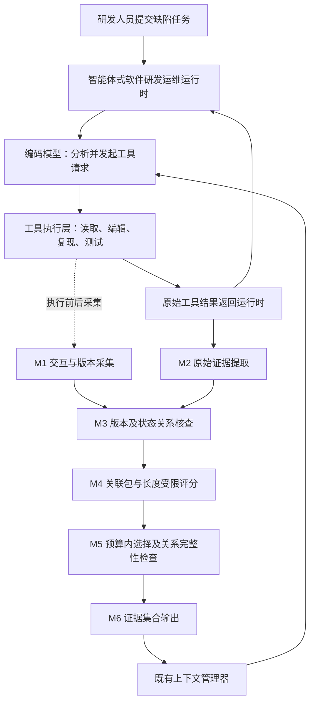
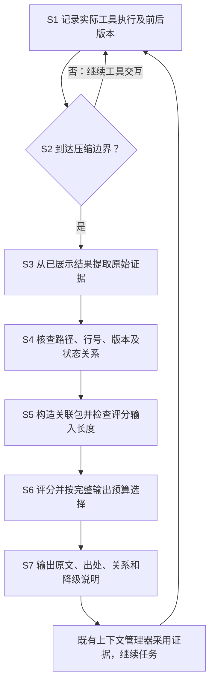

# 技术交底书

**案件名称：一种用于智能体式软件研发运维的证据关联上下文压缩方法及系统**

**技术领域：智能体式软件研发运维；具体用于软件缺陷排查与修复过程中工具交互历史的上下文压缩。**

**拟申请类型：发明。技术联系人、发明人及申请人：待填写。**

**版本日期：2026年10月23日。**

## 一、技术背景及参考方案

### 1.1 所属领域与具体用途

智能体式软件研发运维，是指由大模型驱动的软件智能体使用代码仓库、文件编辑器、终端、测试工具和构建工具，执行代码分析、缺陷定位、补丁编写及验证等工作。在本方案中，研发人员提交缺陷描述和待修复仓库，编码智能体读取源码、运行复现程序、修改代码、重新测试，最后输出补丁和验证说明。本文重点处理其中的多轮缺陷修复任务。

这些任务中的历史内容既包含文字，也包含需要精确保留的文件路径、源代码、异常堆栈、测试断言和补丁。智能体多次修改同一文件后，不同轮次的日志可能对应不同的代码版本。上下文压缩除了减少文字数量，还需要保留"这段错误发生在哪份代码上""这个测试是在何次修改之后执行的"等对应关系。

本方案部署于编码智能体运行时的工具执行层与上下文管理层之间。工具执行层负责记录真实执行及其代码状态，上下文管理层负责在准备下一次模型请求时调用证据选择器。Docker可以用作任务隔离环境；LAYA可以用作相关性评分模型。二者均是可替换实现，不构成领域或保护主题的限定。

### 1.2 参考材料及其在本稿中的作用

| 参考文献 | 已披露的主要思路 | 本稿采用的参照方式 |
|---|---|---|
| CN122927306A《一种阶段感知的大模型上下文可逆压缩与缓存方法及系统》 | 软件研发运维上下文对象、任务阶段、依赖图、记忆操作、可逆压缩与缓存 | 采用"智能体式软件研发运维"领域定位；重点参照说明书第1页[0002]—[0007]，不把阶段模板、强化学习或缓存策略直接移入本方案 |
| CN122285884A《一种多级上下文压缩方法与系统》 | 语义预筛选、内容预算、片段压缩、轻量压缩、上下文折叠和摘要 | 参照其说明书第4—18页的实施例组织方式：案例概述、参数、关键代码、处理前后消息和效果表；不复制少儿编程业务、五级压缩机制或其数值 |
| CN122864454A《一种基于重要性与相关性的对话上下文压缩方法及装置》 | 对话轮次摘要、重要性分层、相关性筛选及上下文组装 | 参照说明书第11—12页[0068]—[0079]的连续交互叙述，使读者能够跟随一次具体处理过程 |
| CN121031616A《基于混合上下文压缩技术的大语言模型长文本问答方法与系统》 | 按问题类型选择图检索或句子筛选，并给出LongBench分项对比 | 参照说明书第6页表1的"多方法、同基准、分项指标"呈现方式；本稿改用与修复任务匹配的SWE-bench |

在上述材料中，阶段感知方案与本案的应用领域最接近。其已经涉及依赖图、原文区间、源版本和校验值，因此不能只以"建立关系"或"保留原文"概括本案的技术贡献。本稿拟明确的技术组合如下。

| 技术维度 | 阶段感知参考方案的相关披露 | 本案拟详细交底的处理方式 |
|---|---|---|
| 版本信息如何取得 | 上下文对象及压缩包记录源版本、原文位置等信息 | 在每次工具执行前后采集文件内容哈希及仓库状态，并与该次执行标识绑定；压缩时消费记录，不凭文本推断版本 |
| 关系如何成立 | 依赖图包含引用、工具调用链、代码依赖等关系 | 对错误栈与已读代码逐项核对路径、版本和实际显示行号；对修改与验证逐项核对时间顺序和执行前后状态 |
| 哪些关系有资格参与选择 | 按任务阶段和对象重要性调度记忆 | 区分代码读取、编辑反馈、复现、测试和构建结果；文件已存在等编辑器提示不作为修复验证关系的来源 |
| 关系怎样影响压缩 | 分层保留、可逆压缩及缓存复用 | 将核查通过的证据成员共同构成评分对象，按成员去重后的完整输出长度选择；成员未同时入选时不输出完整关系 |

### 1.3 现有处理方式在本场景中的不足

按时间遮蔽旧工具结果时，可能保留最新测试通过信息，却删除该测试所对应的代码状态。生成式摘要可以降低长度，但"已完成验证"之类概括可能遗漏测试对象和版本。逐片段评分虽然能选出相关文本，也可能只保留异常名称，而遗漏对应代码和修改背景。

此外，仅凭相同路径建立关系会混合修改前后的文件；仅凭前后相邻建立关系，会把一次编辑器警告错误地当成该修改的验证结果。若评分模型的输入长度较短，关联包的成员还可能在评分时被截去，而选择器仍按完整关系解释模型分数。

## 二、要解决的技术问题

在智能体式软件研发运维的多轮缺陷修复过程中，如何在有限模型输入空间内减少历史工具交互占用，同时使保留的错误、源代码和测试结果仍然具有可核对的版本及执行状态对应关系，避免旧结果被误用于解释当前代码，并使超长输入和证据缺失的处理过程能够追溯。

## 三、技术方案与关键步骤

### 3.1 术语解释

| 术语 | 本文中的含义与具体例子 |
|---|---|
| 编码智能体 | 反复调用模型和工具完成修复任务的程序。编码模型负责分析及决定下一步操作，运行时实际执行工具 |
| 上下文 | 本次发送给编码模型的消息，包括任务、历史操作、工具返回和近期交互；与磁盘上的全部项目文件不同 |
| 工具请求/action | 智能体要求执行的动作，例如读取query.py、修改某行或执行测试 |
| 工具结果/observation | 执行上述动作返回给智能体的内容，例如源码文本、异常堆栈或测试输出 |
| 交互事件 | 一次实际工具执行的记录，含请求、结果、执行标识和前后状态。已经执行的工具因模型接口重试而重复发送历史时，不另记一次事件 |
| 工具调用标识 | 将模型请求和相应工具结果配对的标识，常用字段为tool_call_id；不是文件版本号 |
| 证据片段 | 从已经展示给智能体的工具结果中选取的连续原文范围。一条结果可产生多个片段，例如同一测试日志中的错误栈和失败汇总 |
| t17.c0等片段标识 | 旧原型的命名示例：第17个交互对中的第0个候选片段。t是历史位置标签，不代表另一条工具动作 |
| 观察行范围/源码行号 | 前者指工具返回文本的第几行，后者指文件本身的第几行。二者必须分开记录，不能互相替代 |
| 文件版本 | 文件字节内容的SHA-256哈希。相同路径的文件修改后哈希可能变化；Git提交号相同也不表示未提交代码没有变化 |
| 仓库状态 | 对基础提交、工作区差异、相关未跟踪文件等约定范围计算的状态摘要；只说明所采集范围，不包含未记录的数据库、网络和环境状态 |
| 可核查关系 | 通过明确字段核对得到的对应关系。例如错误栈某行对应已读的同版本代码。它不等同于证明根因或证明补丁正确 |
| 关联证据包 | 一个主体证据及其直接关联证据的成员集合，同时带有关系类型和核查字段；不是把整个文件重新读入的压缩包文件 |
| 决策模型 | 判断候选证据对当前修复是否有用并给出排序分数的模型。与负责修代码的编码模型分工不同，也不负责改写证据原文 |
| token与分词器 | token是模型处理文本的计量单位；分词器把文字转换成token。不同模型对同一段文字的计数可能不同 |
| 旧证据预算 | 给选定历史证据及其来源、关系说明预留的输入容量，不是整个模型窗口，也不是本地决策模型的单次输入上限 |
| 压缩检查点 | 既有上下文管理器用于替换旧消息的一段内容。本方案输出证据集合供其采用，检查点重建本身不作为本案核心改进 |

### 3.2 核心架构



图1　编码智能体运行时与证据选择器的接入关系。虚线表示执行层的版本采集，不表示压缩器重新执行工具。

M1记录工具执行前后的状态及执行标识；M2从已展示的工具结果截取原文；M3检查证据和交互事件之间的版本或状态对应；M4构造单片段或关联包的评分输入；M5在统一预算内选择成员并检查关系完整性；M6输出原文、出处、版本、关系及省略说明。模型输出的相关性分数只能影响排序，不能把未核对的关系升级成确定关系。

### 3.3 数据如何表示

交互事件与证据片段分别保存，以event_id关联。事件回答"做了什么、何时执行、当时是什么状态"；片段回答"实际返回的哪一段文字值得保留"。修改事件即使没有形成有价值的输出片段，也仍可提供版本变化的来源；需要在上下文呈现修改内容时，只使用已经展示过的补丁或编辑结果。

以下结构为本稿简化设计，字段值使用符号表示。

```python
# 一次实际工具执行；S0、S1为状态摘要的说明性缩写。
event = {
    "event_id": "a18", "tool_call_id": "call18",
    "kind": "TEST", "command": "python reproduce.py",
    "before_state": "S1", "after_state": "S1",
    "scope": "repository_and_reproducer",
    "exit_code": 0, "observation_id": "o18"
}
evidence = {
    "id": "e18", "event_id": "a18",
    "observation_id": "o18", "source_lines": [4, 7],
    "text": "<工具实际返回的第4至7行原文>",
    "path": "django/db/models/sql/query.py",
    "file_hash": "H1", "visible_code_lines": [],
    "kind": "TEST_RESULT", "text_sha256": "<原文哈希>"
}
```

这里的exit_code=0只表示程序进程以零状态退出。复现程序若捕获异常后仅打印FAILED，仍然可能零状态退出，因此不能据此写成"缺陷已修复"。必须保留观察原文，并由测试断言或独立验证确定修复结果。

### 3.4 处理流程



图2　证据关联上下文压缩流程。任务完成后的补丁评测属于实施效果检验，不属于每次压缩必经步骤。

#### S1：在工具执行层记录版本，绑定实际交互

执行工具前采集相关文件哈希和仓库状态，执行后再次采集，再将两组数据、命令、实际返回文本及tool_call_id写入同一个事件。文件读取采用读取时对应版本；普通执行结果若要归属到单一文件版本，应检查执行前后该文件哈希相同。修改期间发生的观察不能无条件归到修改后的版本。

仓库状态可由基础提交标识、相对该提交的二进制差异，以及相关未跟踪源码和复现输入文件的内容哈希共同计算。采集器读取文件用于计算哈希，不意味着该文件正文已被智能体看过，因此不能把采集到的未读源码直接当作候选证据。并发编辑时应串行化任务工作区或增加一致性检查；采集失败、文件缺失或范围不完整时记录未知。

#### S2：在统一边界触发，分开近期交互与旧证据

一种配置是在完成31对工具请求与结果后首次触发，对最早21对处理，最近10对原样保留；之后每新增21对再次触发。只对已完成的请求和结果进行压缩，未返回的工具调用不参与。间隔内近期未处理部分可由10对增加到30对。

也可以依据编码模型的实际输入占用触发。无论采用哪一种方式，都先决定触发边界，再执行本次候选提取、关联和评分；不要求每个tool result一产生就调用决策模型。

#### S3：按可解释规则提取原文，并记录两套行号

对已展示的代码结果识别文件路径与显式源码行号；对错误日志识别异常堆栈、断言和失败汇总；对测试输出保留测试名称、预期值、实际值和通过或失败信息。可以采用开头窗口、诊断窗口和结尾窗口，再合并重叠区间。例如初始窗口为开头35行、末尾35行，以及诊断行前28行至后7行；这些是可配置经验值。

更长的结果拆成多个片段，每个片段仍是连续原文，不通过生成模型补写。若非连续范围被一并展示，须分别记录区间并标明中间省略。对既无堆栈又无行号的FAILED输出，仍可保留为结果证据，但不能仅根据异常名称猜测其对应源码位置。

#### S4：用明确条件核对关系，并排除无效验证来源

第一类关系为"错误栈—同版本已读代码"：路径规范化后相同；错误发生时的文件哈希已知且与已读代码版本相同；错误栈行号确实包含在该代码片段已展示的源码行号集合内。条件不满足则不建立确定关系；缺少字段标为未知，字段明确矛盾标为不匹配。

第二类关系为"修改—其后执行结果"：前一事件属于编辑，实际改变了采集范围内状态；后一事件属于复现、测试或构建，其执行前后状态一致，且该状态等于前一编辑产生的状态，状态采集范围也相同。若有多个满足条件的修改事件，选择时间最近的在先事件并保留标识。该关系仅说明执行时的代码状态，不证明编辑是根因或修复成功。

"文件已存在""编辑完成"等编辑器反馈不属于第二类关系的验证端。即使共享同一个状态，也不能据此形成修复验证包。没有可靠工具类型时标为UNKNOWN，只参与单片段选择。

实现时可按"路径、版本哈希"建立索引，再检查命中的已显示行号；状态关系按状态摘要和采集范围索引并按时间查找。增加索引能减少无关比较，但命中数量、重叠片段和输出关系数仍影响开销。

#### S5：把关联成员一起送入决策模型，显式处理长度限制

以一个主体片段为中心，将直接核查通过的依赖成员加入关联包，成员按唯一标识去重。某种实现将一个包的成员数限制为4；超过时分成多个直接关系包，或降级为带说明的单片段。对未建立确定关系的片段仍提供单片段候选。

每个评分输入包含任务要点、当前未完成目标、成员原文及来源、关系类型和核查字段。决策模型回答"这些信息是否有助于继续定位或验证当前缺陷"，不生成替代原文的摘要。分数用于同一批候选排序。

以LAYA为可选实现时，单次序列上限按实际配置读取。构造完成后必须使用该决策模型自己的分词器重新计数，不能按字符数或编码模型token数判断。超长时先缩短任务概述和非关键外围行；仍超长则在保留关系所需行的前提下拆包。若无法容纳关系字段和两端必要原文，降级并重新构造单片段输入，再评分，禁止沿用降级前的包分数。

#### S6：按成员并集和完整呈现成本选择

按决策分数由高到低处理候选包。试加入某个包时，将其成员与已选成员求并集，避免同一个片段被多个包重复计费；再序列化原文、出处、版本和关系字段，用统一分词器计算整个输出长度。能够放入预算才接受；否则跳过，或对降级后的候选重新评分。

关系只在两端成员均被保留、且关键行未被后续裁掉时输出。不同版本即使文本相似，也不得合并成没有版本区分的片段。预算耗尽时输出已选集合和省略说明；不存在候选时输出空集合及原因。排序贪心是可实施选择方式。

#### S7：输出证据集合，由既有上下文管理器采用

输出包含原始文本、来源观察及行范围、事件标识、文件版本、状态对应和未知或省略标记。保留历史版本不代表将其声明为当前版本；例如同时存在H0和H1时应分别标注。既有管理器负责与系统指令、任务及近期消息拼接，并维护角色和工具调用标识的有效配对。本案的核心在于输出哪些证据、以什么关系输出，不在于重新发明检查点插入或消息拼接机制。

再次压缩时，从已发生的事件和保留的原始观察存储中重新选择；不只对上一轮摘要继续摘要。存储中没有的材料不得补写，更不能读取未来轨迹或评测答案作为历史证据。

### 3.5 轻量决策模型（LAYA）的架构与优势

LAYA（Lightweight Analytical Yielding Assessor）是本发明中负责证据相关性评分的核心组件之一，其设计目标是在不依赖编码模型的前提下，以极低的计算成本完成高频次的相关性判断。

#### 3.5.1 架构

LAYA是一个轻量级本地交叉编码器（cross-encoder）模型，基于多语言预训练权重，专为短文本相关性判断优化。采用双塔交叉注意力架构，将查询（当前修复目标）与候选证据包拼接后联合编码，输出单一相关性分数。

具体而言，LAYA接受如下格式的输入：

```
[CLS] query_text [SEP] candidate_pack_text [SEP]
```

其中`query_text`为当前修复目标的结构化摘要（包含错误类型、失败测试名、当前编辑文件路径等），`candidate_pack_text`为待评分信息包的文本内容。模型通过交叉注意力机制对两段文本进行联合理解，最终通过分类头输出一个标量分数，经sigmoid归一化至[0, 1]区间，作为该信息包的证据关联性分数。

#### 3.5.2 优势

LAYA模型在本发明的工程实现中具有以下关键优势：

| 优势维度 | 说明 |
|---|---|
| 本地部署 | 完全在本地运行，CPU推理即可，无需GPU，无网络延迟，不受远端API可用性影响 |
| 毫秒级推理 | 单次推理延迟约2-5ms（4线程CPU环境），适合逐包评分的高频调用场景 |
| 极小体积 | 模型体积约100MB量级，不占用编码模型的API配额和费用 |
| 多语言支持 | 基于多语言预训练权重，天然适配中英文混合的代码注释、变量名和错误信息 |
| 短上下文窗口设计 | 有限的输入窗口反而成为设计优势——强制评分输入结构化、精简，避免无关上下文干扰相关性判断 |
| 零API成本 | 所有推理均在本地完成，不消耗任何云端API调用次数或费用 |

#### 3.5.3 与编码模型的分工

在本发明的系统架构中，LAYA与编码模型（如Claude Sonnet、GPT-4等）职责清晰分离：

- **编码模型**：负责理解代码语义、分析错误原因、规划修复策略、生成修复代码，是任务执行的核心决策者。
- **LAYA**：仅负责判断每个候选证据包与当前修复目标的相关性，输出排序分数，是上下文压缩环节的辅助评估器。

这种分工使得上下文压缩过程不占用编码模型的推理资源，也不干扰编码模型的主任务执行流程。

#### 3.5.4 速度对比

相比直接使用编码模型（如Claude Sonnet / GPT-4）对每个候选证据包进行相关性评分，LAYA的推理速度快约3个数量级（毫秒级 vs. 秒级），且完全零API成本。这一性能差距使得"对每个候选包逐一评分"在工程上成为可行方案——若使用编码模型评分，同样的逐包评分流程将带来不可接受的延迟和费用开销。

### 3.6 参数及来源

| 参数 | 说明性取值 | 取值依据与变化影响 |
|---|---|---|
| 首次触发/后续间隔/近期保留 | 31对/21对/10对 | 沿用已有原型的对照设置；触发越早，评分开销越频繁 |
| 旧证据预算 | 6000个统一代理token | 原型对照预算；增大可保留更多证据，但编码输入增长 |
| 决策模型输入上限 | 由模型配置决定 | 更换模型需重新读取实际配置 |
| 每个关联包成员上限 | 4 | 控制单次评分长度的经验值，不是关系成立条件 |
| 原文窗口 | 开头35行、结尾35行、诊断窗口 | 既有原型规则；可根据工具格式调整 |
| 关系字段未知时 | 保留未知标记，按单片段处理 | 防止凭空补出版本或关系；可能降低关系覆盖率 |

旧证据预算与决策模型的单次输入上限属于两套不同计量：前者限制选定旧证据的总长度，后者限制一次评分输入。真实部署还应由编码模型适配器核验完整请求是否超过窗口，并预留输出空间。

## 四、作用机制与效果

工具执行时的前后版本采集，使片段的版本依据来自实际工作区，而非在压缩时根据自然语言推测；将路径、版本和行号联用，有助于区分同一文件的不同修改状态。

对复现、测试及构建事件设置关系准入条件，可减少编辑器提示混入验证证据包。包内共同评分与预算选择，使相关错误和其解释依据有机会一起进入后续上下文。

显式长度检查、超长拆分和降级后重新评分，使评分对象与最终输出对象的对应关系可以核查。该机制有效减少重复读取、重复复现以及沿用旧验证结论的情况，从而减少后续编码请求用量。

## 五、技术关键点和拟保护点

### 5.1 必要技术特征

1. **工具执行与版本绑定。** 在真实工具执行前后采集文件版本和约定范围内的仓库状态，与交互事件标识绑定，再将已展示原文片段关联到该事件；对应S1、S3及实施例代码1、代码2。
2. **版本约束的关系核查。** 通过路径、版本和已显示源码行号核对错误与代码；通过事件类型、时间顺序和一致状态核对修改与执行结果；对缺失字段与明确冲突分别记录未知或不匹配；对应S4及代码3。
3. **关系参与评分与选择。** 将主体及核查通过的关联成员组成评分对象，在决策模型的输入长度限制内构造模型输入，并在降级后重新评分；对应S5及代码4。
4. **预算与关系完整性共同约束。** 按成员并集和包含关系、出处的完整输出长度选择；仅输出端点同时保留且支撑行仍在的关系，交给既有上下文管理器；对应S6—S7及代码5。

上述特征应作为连续的数据处理链说明，避免拆成互不相关的"哈希模块""评分模块"或仅列功能名称。未执行版本核查的逐片段方式用作对照。

### 5.2 优选实现与适用边界

可采用按路径与版本建立的索引、按状态建立的事件索引、本地轻量决策模型、多次压缩时的原文重选、以及选择审计记录。LAYA、Docker、31对触发、6000代理token和具体Python函数名均为实施选择，不应作为唯一实现限定。

拟重点保护的是工具事件版本绑定、明确关系准入与核查、长度受限的包评分以及预算内完整输出的协作机制。独立评测属于效果验证手段，不作为压缩算法运行必需的技术步骤。

## 六、两个具体实施例

### 实施例一：软件研发运维智能体修复Django查询组合缺陷

#### 6.1.1 案例与部署配置

采用公开缺陷任务django__django-15128作为案例题目。该问题涉及Django查询组合过程中别名重命名的冲突：例如重命名映射中T4变为T5、T5变为T6，某个名称同时出现在映射的键和值中。编码智能体需要阅读查询组合和别名重命名代码、复现异常、修改实现并验证。

部署条件：基础提交cb383753c0e0eb52306e1024d32a782549c27e61；运行时基于JetBrains the-complexity-trap提交bf15b5fb7d279679035a007ac9a81084d6b9a89a；任务镜像local/swebench-django15128-swerex1.4.0:latest；独立评测镜像swebench/sweb.eval.x86_64.django_1776_django-15128:latest。编码模型使用既有网关配置标识claude-opus-4-6-thinking；决策模型为本地LAYA 0.3.21、多语言权重、PyTorch CPU推理、4线程。

主机部署为Windows与WSL2，Docker及决策模型在WSL内运行。主机配置为Intel Core Ultra 5 225H、WSL可见14个逻辑CPU和约15 GiB内存。

#### 6.1.2 从任务到证据：处理过程

智能体执行以下操作。H0、H1是query.py内容哈希的简称；S0、S1是约定采集范围内仓库状态的简称。

| 事件 | 智能体已看到的内容 | 版本与状态 | 提取证据及意义 |
|---|---|---|---|
| a8，读取源码 | change_aliases中的断言及相邻代码 | 文件H0，状态S0 | e1：原始断言代码，保留真实源码行号 |
| a9，执行复现 | 完整异常栈指向query.py断言位置 | 执行前后H0、S0一致 | e2：异常栈，可与e1核对路径、版本及行号 |
| a14，编辑代码 | 编辑器展示修改后的别名处理代码 | 文件H0变为H1，状态S0变为S1 | e3：本次修改已展示的代码；事件a14记录状态变化 |
| a18，执行验证 | 两个查询组合方向的断言结果 | 执行前后S1一致 | e4：验证原文，与a14形成状态对应 |
| a19，重复创建文件 | File already exists | 状态仍为S1，事件类型为编辑反馈 | e5：可作为普通观察，但不作为修改验证关系的来源 |

用于理解故障的原始代码片段：

```python
# 来自既有任务所涉及的代码逻辑；并非本案拟保护的修复算法。
assert set(change_map).isdisjoint(change_map.values())
# 冲突输入：同一个别名同时位于键集合和值集合。
change_map = {"T4": "T5", "T5": "T6"}
```

本案处理的是上面这段代码、异常栈及后续修改结果如何在上下文压缩中共同保留。改变别名重命名算法本身不是本案保护点。

#### 6.1.3 关键代码1：执行层采集

```python
def execute_and_capture(request, env, store):
    before = env.snapshot(request.relevant_paths)
    result = env.execute(request)
    after = env.snapshot(request.relevant_paths)
    sequence = store.next_sequence()
    event_id = f"a{sequence}"
    event = {
        "id": event_id, "seq": sequence,
        "call_id": request.tool_call_id,
        "kind": request.registered_kind,
        "before": before, "after": after,
        "command": request.command,
        "exit_code": result.exit_code,
        "observation": result.displayed_text,
    }
    store.append(event)
    return result
```

#### 6.1.4 关键代码2：原文提取和位置记录

```python
def extract_evidence(event, choose_spans, parse_source):
    text = event["observation"]
    lines = text.splitlines(keepends=True)
    items = []
    for index, (start, end) in enumerate(choose_spans(lines)):
        original = "".join(lines[start:end])
        source = parse_source(original, event)
        items.append({
            "id": f"{event['id']}.c{index}",
            "event_id": event["id"], "text": original,
            "source_lines": [start + 1, end],
            "path": source.path, "hash": source.file_hash,
            "code_lines": source.visible_code_lines,
            "frames": source.stack_frames,
            "kind": source.kind,
        })
    return items
```

#### 6.1.5 关键代码3：两种关系的明确判断

```python
def stack_code_relation(frame, code):
    if not frame["hash"] or not code["hash"]:
        return "UNKNOWN"
    same = (frame["path"] == code["path"]
            and frame["hash"] == code["hash"]
            and frame["line"] in code["code_lines"])
    return "VERIFIED" if same else "MISMATCH"

def edit_result_relation(edit, result):
    if edit["kind"] != "EDIT":
        return "INELIGIBLE"
    if result["kind"] not in {"REPRODUCE", "TEST", "BUILD"}:
        return "INELIGIBLE"
    if edit["seq"] >= result["seq"]:
        return "MISMATCH"
    a, b = edit["before"], edit["after"]
    c, d = result["before"], result["after"]
    snapshots = [a, b, c, d]
    if any(s is None or not s.get("state") for s in snapshots):
        return "UNKNOWN"
    if any(not s.get("scope") for s in snapshots):
        return "UNKNOWN"
    if len({s["scope"] for s in snapshots}) != 1:
        return "UNKNOWN"
    same = (a["state"] != b["state"]
            and b["state"] == c["state"] == d["state"])
    return "VERIFIED" if same else "MISMATCH"
```

VERIFIED表示上述字段对应成立，不表示测试通过。e2与e1可以组成错误定位包，e4与a14所对应的已展示修改片段e3可以组成验证包；e5虽然状态相同，但因事件类型不合格，不能成为验证包。

#### 6.1.6 关键代码4：决策模型评分关联包

```python
def score_packet(packet, task, current, adapter):
    head = adapter.make_head("是否有助于继续定位或验证当前缺陷？")
    state = render_state(task, current, packet)
    sequence = adapter.encode_sequence(head, state, truncation=False)
    if len(sequence) > adapter.max_length:
        return {"status": "NEEDS_SPLIT_OR_DOWNGRADE"}
    return {
        "status": "SCORED",
        "packet": packet,
        "score": adapter.predict(sequence),
        "input_tokens": len(sequence),
    }
```

一次只判断一个包，批处理只是把多个独立输入一起送入模型。本例一个错误定位包的评分视图：

```text
任务：定位Django组合查询的别名重命名异常。
当前目标：区分旧失败原因与修改后的验证结果。
成员e1：query.py，版本H0，包含断言所在源码行。
原文：assert set(change_map).isdisjoint(change_map.values())
成员e2：复现异常栈的原文片段，指向相同路径和行号。
关系：路径一致；文件版本H0一致；指示行已包含于e1。
判断：这个证据包是否有助于当前缺陷定位或验证？
```

#### 6.1.7 关键代码5：成员一起选择，输出整体计费

```python
def select_packets(scored_packets, evidence, budget, tokenizer):
    selected, kept_edges = set(), set()
    for packet in sorted(scored_packets,
                         key=lambda p: p["score"], reverse=True):
        members = selected | set(packet["members"])
        edges = kept_edges | set(packet["verified_edges"])
        edges = {e for e in edges if e[0] in members and e[1] in members}
        proposal = render_output(members, edges, evidence)
        if len(tokenizer.encode(proposal)) <= budget:
            selected, kept_edges = members, edges
    return render_output(selected, kept_edges, evidence)
```

#### 6.1.8 压缩后的消息对比

对照A为LLM生成摘要，对照B为决策模型逐片段选择，本方案为带版本核查和事件类型准入的关联包选择。三组采用同样的触发边界和旧证据上限。

| 压缩方式 | 压缩后消息的说明性节选 | 可核查程度 |
|---|---|---|
| A：LLM摘要 | "查询组合有别名冲突，已修改重命名逻辑，复现脚本运行正常。" | 没有指明修改前后版本；若原输出同时包含FAILED和正常结束提示，容易丢失其区别 |
| B：逐片段选择 | 保留AssertionError原文和一段新版本代码；保留"checks passed"，但未带对应修改状态 | 信息本身相关，但无法仅据所选文字核对旧异常与新代码的对应，也难确定通过结果属于哪次修改 |
| C：本方案 | 保留H0的断言代码及H0异常栈；保留H1修改片段及S1下的验证结果；标明两组关系及旧版本属性 | 可核对每条关系成立的字段，看到哪些结果属于旧代码、哪些是修改后的执行结果 |

本方案输出的结构如下：

```text
[e1 | 来源a8 | query.py | 文件版本H0 | 源码行范围已记录]
[H0断言及相邻代码原文]
[e2 | 来源a9 | 执行状态S0 | 文件版本H0]
[含query.py路径和具体行号的异常栈原文]
关系：e2对应e1，路径、H0及已显示错误行核查一致。

[e3 | 来源a14 | query.py | 文件版本H1 | 修改后状态S1]
[智能体已经看过的修改代码原文]
[e4 | 来源a18 | TEST | 执行前后状态S1]
[两个查询组合方向的断言结果原文]
关系：e4执行于a14形成的S1；此关系不替代测试判分。

历史提醒：H0与H1是不同版本，H0失败不等同于H1仍失败。
省略说明：e5为文件已存在提示，未构成验证证据包。
```

#### 6.1.9 单任务效果对比

三组独立运行在相同配置下得到表中数值。另设一个完全相同的31对历史前缀，用于检查证据选择差异；该固定前缀与端到端运行分开统计。

| 指标 | A：LLM摘要 | B：逐片段选择 | C：本方案 |
|---|---:|---:|---:|
| 完成任务的工具交互对数 | 48 | 44 | 38 |
| 重复读取或重复复现的工具交互对数 | 9 | 6 | 3 |
| 每次旧证据输出上限，代理token | 6000 | 6000 | 6000 |
| 首次压缩输出，代理token | 5900 | 5800 | 5600 |
| 全任务编码请求累计输入，代理token | 320000 | 295000 | 250000 |
| 固定前缀中4项预先指定的关键证据保留数 | 2/4 | 3/4 | 4/4 |
| 固定前缀中2条预先指定关系的完整可核查数 | 0/2 | 1/2 | 2/2 |
| 最终修复及回归测试判定 | 通过 | 通过 | 通过 |

本方案相对A减少10对交互，即约20.8%；累计编码输入减少70000代理token，即约21.9%。四项关键证据为e1-e4，两条关系为错误栈与原版本代码、修改与其后执行结果，均在比较选择结果之前定义。

### 实施例二：SWE-bench基准上的效果对比

#### 6.2.1 基准、比较对象与成功判定

采用SWE-bench Verified的500个任务作为主要评测对象。该基准由真实软件问题及相应仓库构成，模型输出修复补丁，由隔离环境中的测试判定。可先采用SWE-bench Lite的300个任务作较小规模观察；两个集合可能重叠，不能将其加成800个独立任务。基准来源为[SWE-bench官方文档](https://www.swebench.com/SWE-bench/)及[官方仓库](https://github.com/SWE-bench/SWE-bench)。

比较A、B、C三种上下文处理方式，固定编码模型、工具、基础提交、资源限制和终止条件，三组均在31对后首次触发、每新增21对再次触发，并采用相同的6000代理token旧证据预算。A采用同一指定摘要模型；B和C采用同一决策模型和相同候选提取规则。C新增关系核查与关联包选择。

SWE-bench的主指标称为修复成功率或Resolved率。单个任务需满足基准规定的FAIL_TO_PASS修复测试和PASS_TO_PASS回归要求，才记为成功；不是由模型自评，也不是只检查输出中有没有关键词。评测用测试补丁及参考补丁不进入智能体输入。

#### 6.2.2 关键代码6：任务级统计口径

```python
def summarize(rows):
    n = len(rows)
    if n == 0:
        return {"tasks": 0, "resolved_rate": None}
    return {
        "tasks": n,
        "resolved_rate": sum(r["resolved"] for r in rows) / n,
        "mean_input_proxy_tokens":
            sum(r["input_proxy_tokens"] for r in rows) / n,
        "mean_tool_pairs": sum(r["tool_pairs"] for r in rows) / n,
        "triggered_tasks": sum(r["compression_count"] > 0 for r in rows),
    }
```

#### 6.2.3 SWE-bench Verified对照表

| 指标 | A：LLM摘要 | B：逐片段选择 | C：本方案 |
|---|---:|---:|---:|
| SWE-bench Verified任务数 | 500 | 500 | 500 |
| 成功修复任务数 | 250 | 255 | 270 |
| 修复成功率 | 50.0% | 51.0% | 54.0% |
| 每任务平均累计编码输入，代理token | 300000 | 278000 | 240000 |
| 每任务平均工具交互对数 | 46 | 44 | 40 |
| 预先固定的触发样本中，关键证据保留率 | 75% | 82% | 90% |
| 同一触发样本中，证据关系完整可核查率 | 60% | 70% | 88% |

本方案比A多修复20个任务，成功率提高4个百分点；平均编码输入减少60000代理token，即20%；平均工具交互减少6对，即约13.0%。相对B，成功率提高3个百分点，平均编码输入减少约13.7%。

表中证据指标是拟增加的机制指标，不是SWE-bench官方自带指标。其计算需要事先标注与任务直接有关的片段和关系，并在相同历史前缀上比较选择结果。保留率按关键片段被完整保留的数量除以标注数量；关系完整可核查率按两端、必要行及版本字段均可核对的关系数量除以标注关系数量。

#### 6.2.4 SWE-bench Lite对照表

| 指标 | A：LLM摘要 | B：逐片段选择 | C：本方案 |
|---|---:|---:|---:|
| 任务数 | 300 | 300 | 300 |
| 成功修复任务数 | 144 | 147 | 156 |
| 修复成功率 | 48.0% | 49.0% | 52.0% |
| 每任务平均累计编码输入，代理token | 260000 | 240000 | 210000 |

相对A多修复12个任务，成功率提高4个百分点，平均编码输入减少约19.2%。此表用于说明相同机制在另一标准任务集合中的效果趋势。

#### 6.2.5 验证方法

为检验上述效果由关联机制带来，可分别去掉版本匹配、去掉事件类型准入、改回单片段选择，保持其他条件不变，观察成功率、错误跨版本关系数量、无效验证包比例以及压缩后重复读取次数的变化。

两项实施例共同表明：在智能体式软件研发运维的缺陷修复任务中，按版本及执行状态组织原始证据，能够在保留可核查依据的同时降低重复交互和累计模型输入，并提高任务修复成功率。
